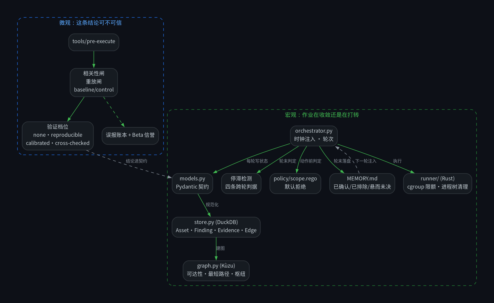
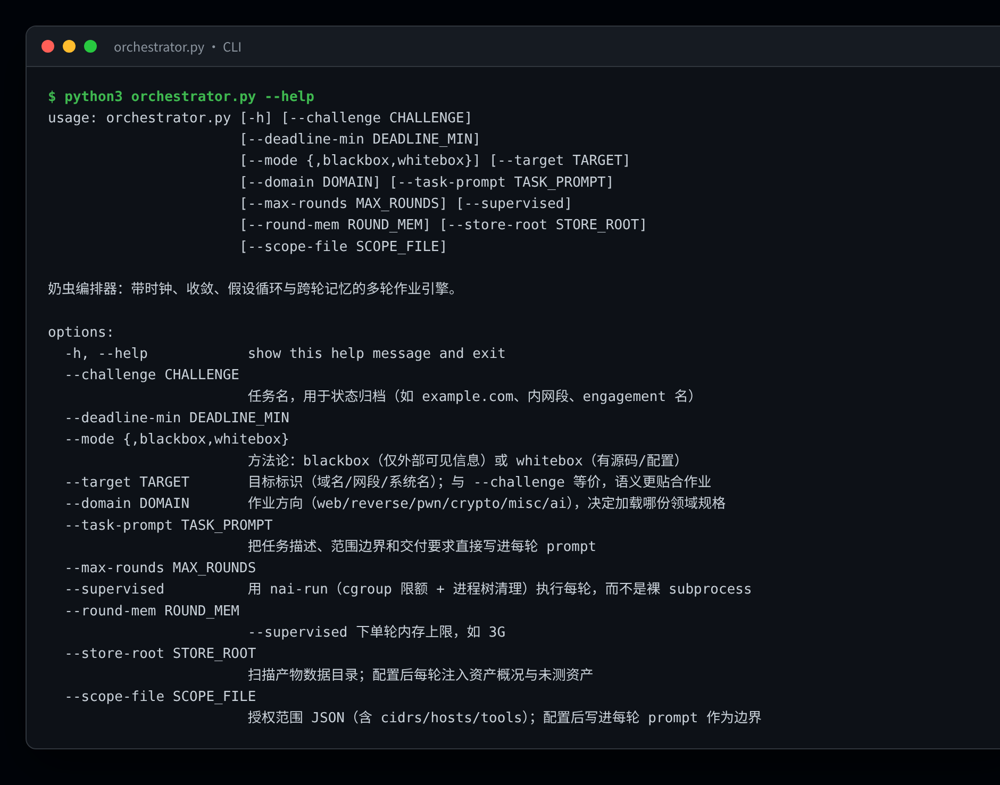
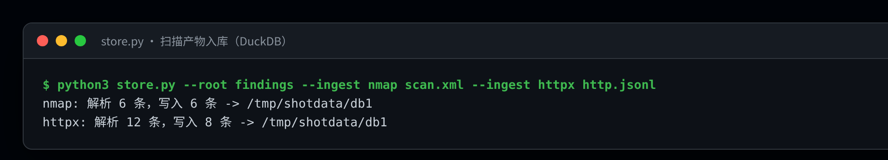
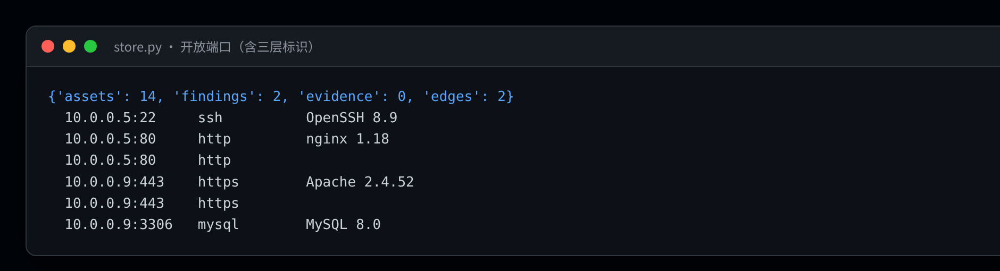
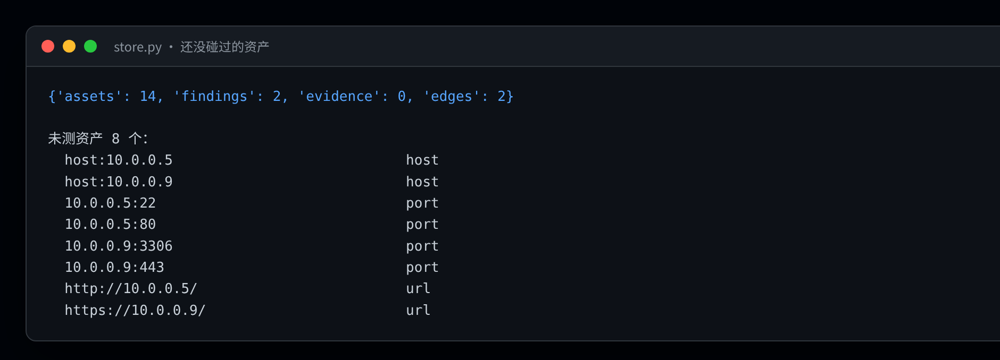
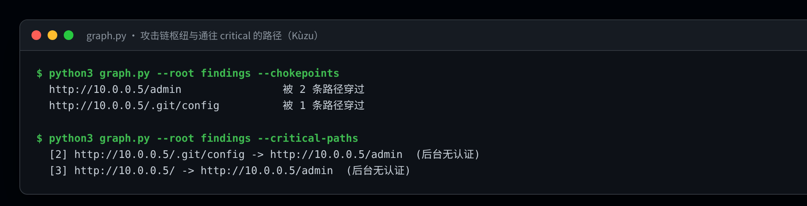
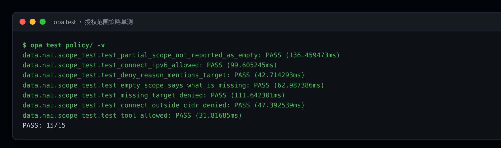
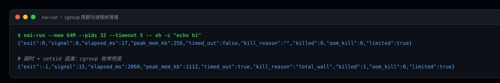

# 奶虫 · NaiChong

**让 AI agent 做渗透时，说出来的每一条结论都经得起复核。**

[](#许可)
[](engine/)
[](dsh-secops/)
[](engine/runner/)
[](engine/policy/)
[](https://github.com/deepseek-ai/deepseek-harness)

[快速开始](#快速开始) · [它拦什么](#它到底拦住了什么) · [真实运行](#跑起来是什么样) · [设计取舍](#设计上的几个取舍) · [FAQ](#faq)



---

## 你大概遇到过这两种情况

**一、agent 报了个漏洞，你复核时发现它压根不存在。**

接口本来就返回那个字段，agent 当成信息泄露；检测器自己坏了，agent 当成目标缺加固；一次 curl 看到 500，agent 当成注入成功。LLM 的自述被当成了证据。

**二、agent 跑了两个小时，你问它进展，它说"正在深入分析"。**

收集了一堆子域、端口、指纹，没有一个验证过的洞。或者在同一思路上反复微调，每轮都以为快有结论了。没人看趋势，没人记住已经排除了什么，预算烧完了。

奶虫针对的是这两件事。它们是**不同尺度**的失效，所以有两层，而不是一个更聪明的 prompt。

## 它到底拦住了什么

### 微观层：这条结论可不可信（`dsh-secops`，TypeScript）

拦在**每次工具调用返回之后**，不满足条件直接 `deny`，不是往上下文里塞一句"请不要"。

| 机制 | 拦的是什么 |
|---|---|
| 相关性闸 | 命令或请求的产出必须触及断言锚点，**自述不算证据** |
| 重放闸 | 支持重放的证据会再跑一次，严格摘要不一致就降级 |
| baseline / control | 只有 proof 没有对照的结论标为弱 |
| 验证档位 | `none` / `reproducible` / `calibrated` / `cross-checked`，四档不压成一个布尔 |
| 误报账本 | 按工具统计「报了多少、被推翻多少」，只算明确归因的推翻 |
| 奖惩信誉 | 判断准不准进入调度排序，旧战绩按半衰期衰减，失误有地板不会一票否决 |
| 捷径拦截 | 跳过验证直接拿结果、绕过边界读敏感文件——第一次就拒 |

### 宏观层：作业在收敛还是在打转（`engine`，Python / Rust / Rego）

作用在**每一轮作业结束后**，决定下一轮该干什么。

| 机制 | 解决的是什么 |
|---|---|
| 时钟注入 | 每轮告诉它「现在几点、还剩多久」。模型没有时间感 |
| 跨轮记忆 | `MEMORY.md` 只放**已确认 / 已排除 / 悬而未决**，不放原始日志 |
| 已排除累积 | 「此路不通」按路径去重进状态，下一轮单列一节 |
| 停滞检测 | 四条跨轮判据，命中 ≥2 条判定停滞，切探索档并把理由注入下一轮 |
| 假设闭环 | 提出 → 验证 → 裁决回填。判死的不许再碰，判活的不许重复验 |
| 产出即收束 | 写完交付物就停，不为「更保险」再跑一轮 |
| 授权范围闸 | 范围从 `if` 挪到 Rego：默认拒绝、可单测、可审计 |
| 受监管执行 | Rust + cgroup v2：硬限额、双超时判据、清理逃逸进程 |

两层可独立使用。只用微观层得到「结论不会太假」；只用宏观层得到「作业不会跑飞」。

## 快速开始

```bash
git clone git@github.com:ZSH402/naichong.git && cd naichong/engine
pip install pydantic duckdb kuzu

cd runner && cargo build --release && cd ..   # 执行层，可选但强烈建议
cp scope/example.json scope/mine.json          # 填你的授权范围

python3 orchestrator.py --target example.com --mode blackbox --domain web \
  --scope-file scope/mine.json --store-root findings \
  --supervised --round-mem 3G --deadline-min 60
```

黑盒与白盒是两套方法论，不是同一个 prompt 换个参数：

```bash
# 黑盒：只有域名 / IP 段
--mode blackbox --domain web

# 白盒：源码放进 attachments/<target>/，另说凭什么下结论
--mode whitebox --domain web
```

| | 黑盒 | 白盒 |
|---|---|---|
| 输入 | 域名 / IP 段 / URL | 源码 / 配置 / IaC / 架构 |
| 第一动作 | 资产发现 → 指纹 → 攻击面枚举 | 入口点清单 → 信任边界 → 数据流追踪 |
| 判定依据 | 对照实验（Body-Diff / 唯一性 / 可重放） | **代码位置 + 实际请求**双证据 |
| 主要误报源 | 版本号当结论、单次差异当漏洞 | 「看起来危险」当「实际可利用」 |
| 典型高估 | 影响范围 | 可达性 |

完整参数：



## 跑起来是什么样

以下每张图都是**实际执行输出**。生成方式是把命令的真实 stdout 套上终端外观再截图，图中每个字符都能被重跑复现。

**扫描产物入库与查询**（DuckDB 直读 JSONL，不建表导入——扫描产物持续产生，每次导入一遍本身就是负担）：



三层标识让「同一个东西的不同视角」能挂在一起：`10.0.0.5:80` 与 `http://10.0.0.5/` 通过 `contains` 边相连，而不是在图上变成两个互不相连的节点：



**「还没碰过的资产」是每轮最该看的清单。** 孤岛判定只看攻击跳转与发现，不看包含关系——一个端口挂在主机下不代表它被探查过：



**攻击路径推理**（Kùzu 图，BFS 剪枝求最短路径）。枢纽节点回答「打穿哪个收益最高」：



**授权范围策略单测**（Rego，默认拒绝）。客户问「你怎么保证没打到范围外」，答案是一份策略加它的测试：



**受监管执行**（Rust + cgroup v2）。第二行是 `setsid` 逃逸场景——`killed:1` 就是 `killpg` 够不到、只能靠 cgroup 枚举揪出来的那个进程：



## 和别的方案比

| | 裸 LLM + 工具 | Agent 框架 | 通用安全扫描器 | 奶虫 |
|---|---|---|---|---|
| 能调工具 | ✅ | ✅ | ✅ | ✅ |
| 结论有验证档位 | ❌ | ❌ | 部分 | ✅ 四档 |
| 误报能被记账和降权 | ❌ | ❌ | ❌ | ✅ Beta 后验 |
| 跨轮记忆不丢 | ❌ | 需自建 | N/A | ✅ 结构化 |
| 停滞能被检测 | ❌ | ❌ | N/A | ✅ 四条判据 |
| 授权范围可审计 | ❌ | ❌ | 部分 | ✅ Rego + 单测 |
| 进程/内存受内核约束 | ❌ | ❌ | ❌ | ✅ cgroup v2 |

奶虫不是扫描器，也不替代扫描器。它解决的是**扫描器输出变多之后，怎么判断哪些能信、下一步该打哪**。

## 目录

```
dsh-secops/            微观层（TypeScript）：断言与证据、方向调度、三公分工、奖惩信誉
engine/                宏观层（Python）
  orchestrator.py        编排主循环：时钟 / 收敛 / 假设 / 记忆 / 停滞
  models.py              Pydantic 数据契约（跨层边界不用裸 dict）
  policy/scope.rego      授权范围策略（默认拒绝，15 条单测）
  scopegate.py           策略的 Python 侧（fail-closed）
  store.py               DuckDB：Asset / Finding / Evidence / Edge
  graph.py               Kùzu 图：可达性 / 最短路径 / 枢纽
  runner.py + runner/    Rust 执行层（cgroup 限额 + 进程树清理）
  agents/                方法论与领域规格（blackbox / whitebox / web / pwn / ...）
dsh-client-ui-secops/  浏览器面板（claim 账本、按工具战绩、时间信用）
desktop/               Electron 桌面壳（宿主由 shell 起，Electron 只当窗口）
config/                cordis 配置模板（已脱敏）
docs/                  设计文档与实战暴露的问题
scripts/               repair.sh、fix-perms.sh
```

## 设计上的几个取舍

**证据不是日志。** 一条证据必须能被第三方重跑复现；重跑得到不同结果，它的档位就降下来。

**`cross-checked` 和 `calibrated` 互不替代。** 前者是「目标行为已对照」，后者是「检测方法已校准」。二进制加固、TLS 配置没有「目标正常态」可比，能证明的只有后者。混成一档等于用「工具可信」冒充「目标已对照」。

**信誉用 Beta 后验而不是朴素比率。** 1 次成功不该显示成 100%。先验 `Beta(1,1)` 同时是惩罚的地板：一次失误把分数从 0.5 压到 0.33，成功一次回到 0.5。

**没跑过的牌按中性算，不给零分。** 评分对零样本返回 0，新工具永远排最后、永远拿不到样本。

**约束落成代码，不靠提示。** 拦截是在 `tools/pre-execute` 返回 `deny`，不是往上下文塞一句「请不要」。提示会被绕过，拒绝不会。

**跨轮记忆不放原始日志。** 只放三类结论。日志里全是失败尝试和挫败感，喂回去只会让下一轮更没方向。

**已排除路径必须跨轮累积。** 它比「上一轮我干了什么」更能防打转。之前它只活在单轮产物里，解析完就丢，等于每轮从零开始排除。

**停滞检测用规则而不是再叫一次模型。** 四条判据全是跨轮累积量，零成本。

**数据契约用 Pydantic 而不是裸 dict。** 教训具体：一条裁决写成 `refuted（…）`（中文括号）被整串比对漏掉，**且不报错**，闭环静默停摆好几轮。校验必须发生在写入时刻。

**进程清理靠 cgroup 而不是字符串匹配。** `pkill -f` 实测六次杀掉自己的 shell；`killpg` 够不到 setsid 出的孙进程，实测留下 7 个孤儿占 1.3GB。可靠的做法只有让内核记账。

**不建表导入，用 VIEW 直接映射文件。** 扫描产物持续产生，ETL 本身就是负担。

## FAQ

**Q：这算不算又一个 agent 框架？**
不算。它不提供 agent 抽象，也不管你用什么模型。它夹在「agent 说完一句话」和「这句话被写进报告」之间，判断这句话够不够格。

**Q：必须用 DeepSeek Harness 吗？**
微观层是 DSH 的 cordis 插件，强绑定。宏观层（`engine/`）是独立 Python，只要能让它调模型就能用。

**Q：没有 cgroup v2 会怎样？**
执行层降级为裸 subprocess，结果里标 `supervised=False`。你失去进程树清理和内存限额，但作业能跑——而且调用方知道自己失去了什么。

**Q：能直接拿去乙方做项目吗？**
不够。它管证据和收敛，不管授权流程、报告模板、客户沟通。缺的那部分不在代码里。

**Q：为什么叫奶虫？**
内部代号，一直没改。代码里一切以 `nai-` / `nai` 为前缀。

**Q：CTF 能用吗？**
曾经用，2026-11 之后不再用于 CTF。`_ctf-archive/` 保留比赛期工具与数据，仅作历史参考，主流程不再引用。

## 已知边界

- 缺陷分类与规则主要面向 Web / 二进制 / TLS / 内网侦察；`post-exploit` 方向目前没有可用候选
- 奖惩信誉吃的是「已定论」的 claim，一次短任务可能攒不出样本，冷启动期主要靠探索项
- claim 记录依赖 `exec.agent.session`，某些组合下 session log 里拿不到，面板因此改读 `claims.jsonl`
- MCP 类工具的判据按各工具自己的输出格式写，换版本可能需要跟着改
- 资产三层标识依赖写入时统一口径；旧数据没有 `parent_id` 时不出包含边，孤岛判定退回按攻击跳转算
- 执行层需要 cgroup v2 可写，容器内通常不可用

## 许可

私有项目，未授权分发。
