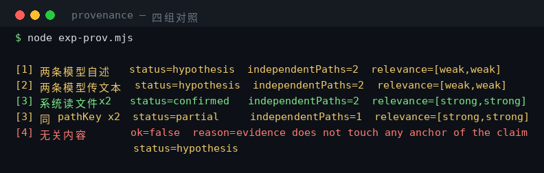
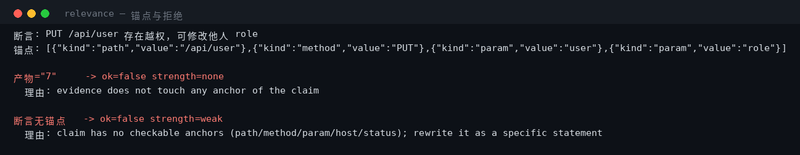

# Agent 的自述为什么不能作为证据

安全测试系统的证据可信度分级

---

## 要判断的东西是什么

一条断言：`PUT /api/user` 存在越权，可修改他人的 role。

系统需要判断它能不能从"假设"走到"已确认"。判据是什么？

这个问题比看起来难。因为**判断的素材由被判断者提供**。agent 说它跑过什么、看到什么，系统手里只有它的说法。让不让它算数，是整套系统能不能交付的分界线——如果算数，那系统输出的每一条"已确认漏洞"都只是一句自我声明。

下面是我把这条线画在哪儿，以及画错两次的过程。

---

## 第一版：数独立路径

最自然的想法是数来源。给每条证据贴一个 `pathKey`，数有多少个不同的 key，凑够两个就算确认。

```ts
function distinctPaths(evidence) {
  return new Set(evidence.map((e) => e.pathKey)).size
}
```

这个数字有个好名字，`independentPaths`，读起来很像"我从两个不同角度验证过了"。

**但它度量的是"有几条不同来路的证据"，不是"证据是否关于这条断言"。**

差别在一个真实案例上暴露了。端到端跑的时候，一条 `PUT /api/user` 越权的断言带上了这样的"证据"：

```sh
node -e "console.log(7)"
```

系统照单全收。

原因很直白：`pathKey` 是模型自己填的。填个 `http:differential` 就是一个独立路径，再填个 `role:other-user` 就是第二个。两条"独立来路"，`confirmed`。

**证据的内容是 `7`。**

这里的问题不是校验不严，是**被度量的对象选错了**。`independentPaths` 度量的是多样性，而"是否关于"度量的是相关性。两个正交的维度，用一个替代了另一个。

更根本的一层：`pathKey` 由模型声明，那"独立路径数"就是模型自己数的。整个机制在自我担保。

---

## 换问题：这条证据的输入是谁提供的

修法不是加校验规则，是换一个问题。

同样是 `curl -X PUT http://target/api/user -d role=admin` 这一行文本，有两种来源：

- 模型在参数里写下的一句话——它可以是任何东西，包括它从未跑过的命令
- 系统从队列任务的 `task.argv` 里取出来的真实 argv——模型碰不到这个字段

文本完全一样，可信度完全不同。所以证据结构里多了一位：

```ts
/**
 * `executed` 是否来自系统记录的真实 argv（例如队列任务的 task.argv）。
 * 模型无法提供这一位，所以自述永远拿不到 strong。
 */
readonly executedTrusted?: boolean
```

关键在**模型有没有途径把它设成 `true`**。这件事不能靠约定，得靠接口形状。

### 工具层：不给口子

模型调用的工具是 `claim_evidence`。它的参数表里**没有"证据内容"这一项**，只有一个文件路径：

```ts
claim_id, ref, path_key, role, note, asset_ids,
evidence_file: {
  description:
    'Path to the file holding the raw output (stdout/stderr/response body) that proves this. ' +
    'The system reads it and matches anchors against its CONTENT. ' +
    'A self-written description is not accepted: relevance is decided by the file, not by your narration.',
}
```

模型给路径，内容由系统 `readFileSync` 读出来。**叙述和证据在接口上就是两回事**，不是靠提示词劝它诚实。

那句 description 是刻意写在工具契约里的：`relevance is decided by the file, not by your narration.` 模型读得到，它知道"我自己编的描述不算"。把规则写进工具签名，比写进系统提示管用。

也没有 `executedTrusted`、没有 `artifactTrusted`。这两位的唯一置位点在队列侧：

```ts
...(task.argv === undefined ? {} : { executed: task.argv.join(' '), executedTrusted: true }),
...(artifact === undefined ? {} : { artifact, artifactTrusted: true }),
```

### 底层：不推断

工具层挡住之后还有一层要挡。

早先底层写的是 `artifactTrusted: evidence.artifact !== undefined`——只要有产物就信。于是模型直接调用底层的 `attach({artifact: '...'})`，一段文本就变成了"系统产物"。

改成 `artifactTrusted: evidence.artifactTrusted === true`。

**能从数据推断出来的信任，就不是信任。** 它必须由知道来源的那一层显式置位。

这道闸是双层的，单靠任何一层都不够：工具层不给口子，底层即使被绕过也不会自动信任。

---

## 四组对照

光说机制没用，得看它拦住了什么。同一条断言，四组证据：



| 组 | 证据来源 | independentPaths | relevance | status |
|---|---|---|---|---|
| 1 | 模型自述的执行命令 ×2 | 2 | `[weak, weak]` | `hypothesis` |
| 2 | 模型传入的产物文本 ×2 | 2 | `[weak, weak]` | `hypothesis` |
| 3 | 系统读取的文件 ×2 | 2 | `[strong, strong]` | **`confirmed`** |
| 3' | 系统读取，但两条 pathKey 相同 | **1** | `[strong, strong]` | `partial` |

**第 1 行里 `independentPaths=2` 和 `status=hypothesis` 并排放着，是整套机制的要害。** 路径数照样数到 2，强度不够，状态就是不动。

第 2 组要单独说：走正常的 `claim_evidence` 工具，模型根本传不进文本（参数里只有 `evidence_file`）。这一组是直接调底层 `attach()`，模拟"某天有人为了省事在工具层加了一个透传"会怎样——结果仍然是 `weak`，因为 `artifactTrusted` 不会从 `artifact !== undefined` 推出来。

第 3' 组是反向对照：同一条路径读两次，两次都是 `strong`，独立路径仍只算 1。**独立性和强度是两个独立维度，任何一个不够都上不去。**

第 4 组是拒绝。产物内容是真实的 `node -e "console.log(7)"` 输出：

```
无关内容  ok=false  reason=evidence does not touch any anchor of the claim
```

这里有个设计取舍值得说：第 1、2 组返回 `ok: true` 但 `weak`，第 4 组返回 `ok: false`。

**"你给的东西不算证据"和"你给的东西跟这件事无关"是两件事。** 前者是降级记录，后者是直接拒绝。混成一个布尔，模型就不知道下一步该改什么。

---

## 锚点：把"关于"变成可计算的

第 4 组能拒绝，靠的是锚点。

一条断言要能核对，必须至少含一个可对照的 token：路径、方法、参数名、主机、状态码。从断言文本里用正则确定性地提出来，不依赖模型说明。



`PUT /api/user 存在越权，可修改他人 role` 提出四个锚点：

```
path=/api/user  method=PUT  param=user  param=role
```

拿证据的实际内容去比对：`7` 一个都不含，拒绝。

两个"为什么不用更聪明的方法"：

**不用 LLM 判相关性。** 那是用模型判断模型的证据，循环论证。而且不可复现——同一输入今天判相关明天判无关，这套系统就没法审计。安全结论是要签字的东西。

**不做文本相似度。** `/api/user` 和 `/api/users` 编辑距离很小，语义完全不同：前者改自己，后者是列表。所以是精确 token 匹配。

参数名这一档做了刻意的收窄。通用标识符提取噪声太大（"存在"、"可以"都会被当词），所以只认两类：`name=` 形式的显式赋值，和一份安全语义高频词表（`id/role/tenant/token/amount/password/...`，约三十个）。

代价很直接：**中文表述提不出锚点**。"改别人的角色"只会命中 `role`，不会命中"角色"。所以断言必须写成含 token 的形式。一句话说"这个接口有越权"，一个锚点都没有，直接拒：

```
断言无锚点  ok=false strength=weak
  理由: claim has no checkable anchors (path/method/param/host/status);
        rewrite it as a specific statement
```

这条拒绝信息是写给模型看的，要求它把断言重写成具体陈述。不是惩罚，是**逼出可核对的形式**——写不出可核对的断言，本身就说明还没想清楚要测什么。

---

## 三种口径，以及为什么不能合成一个分数

状态推进用的是 `verified` 口径，但代码里有三种：

```ts
const count =
  options.mode === 'replay'
    ? new Set(proofOnly
        .filter((e) => e.relevance?.strength === 'strong' && e.replay?.verified === true)
        .map((e) => e.pathKey)).size
    : options.mode === 'verified'
      ? new Set(proofOnly.filter((e) => e.relevance?.strength === 'strong').map((e) => e.pathKey)).size
      : distinctPaths(proofOnly)
if (count >= CONFIRM_THRESHOLD) return 'confirmed'
```

- `paths`：只数路径。最早的口径
- `verified`：要求证据强度 `strong`。**`attach` 实际用的**
- `replay`：还要求真的重跑过一遍且结果一致

为什么要三种：**能确认到什么程度，取决于手里有什么材料。** 真实目标通常不让你重放（重放就有日志、有告警），所以文件证据（attested：内容可核查、未重放）也必须能推进确认，否则整套东西在真实项目里永远停在 `partial`。

把它们合成一个 0~1 的"可信度分数"反而更糟：0.7 是"强证据但没重放"还是"弱证据但重放了"？说不清。而交付物上必须能说清。

---

## 一处注释与实现不符

写这篇文章时我去核 `attach` 的调用点，看到这段注释：

```ts
// 用 verified 模式（按 relevance 推进），但 deriveStatus 里加了一道硬门槛：
// **confirmed 必须至少有一条 replay.verified**。
{ mode: 'verified' },
```

但上面第 3 组实验里，两条文件证据**没做任何重放**就到了 `confirmed`。

去读 `deriveStatus` 的 `verified` 分支，确实没有 replay 门槛——门槛只在 `replay` 分支里。注释描述了一道不存在的闸。

不是 bug，是**注释与实现漂移**：当初大概想加，后来因为"真实项目没法重放"放弃了，注释没跟着改。

危险的地方在于：**注释是写给下一个读代码的人看的，包括三个月后的自己。** 一条声称有安全门实际没有的注释，比没有注释更糟——它会让人放弃自己去核。

已按实测行为改正，并在注释里留了改动原因。

---

## 代价

**锚点是启发式的，覆盖不全。** 中文表述、业务自定义字段名都提不到。代价是断言必须写成含 token 的形式，写不出来的进不来。这是有意的摩擦，但它确实会让一些真断言卡住。

**attested 不等于"真的"。** 文件证据的含义是"系统从模型给的路径读出来的、真实存在的存档"，人可以照着核查。但 `echo "PUT /api/user 200" > f.txt` 也能造出含锚点的文件。这道闸拦的是"随口编"，不是"刻意伪造"。区别在于：伪造需要主动造假并落到文件，随口编不需要——而前者在真实项目里是要担责的。

这和漏洞赏金平台接受截图是同一个逻辑：不要求可重放，要求**内容可核查**。

**`pathKey` 仍然是模型声明的。** 这是整条链上最后一处还靠模型自觉的地方。`independentPaths` 数的是它声明的独立性，不是系统核实的独立性。要真解，得让系统从请求特征（方法 + 路径 + 身份）自己派生 pathKey，而不是接收一个字符串。这件事还没做。

**小样本不自动降级。** 一条断言被两条强证据确认后，如果出现反例，现在只记 `refuted`，不会自动把已有的 `confirmed` 降级。降级牵扯到"哪条证据作废"，目前靠人判断。

---

## 一句话收束

**信任来源不能推断，只能置位。**

能推断出来的东西，就能被构造出来。`artifact !== undefined` 看起来是个合理的推断，实际上等于把"有没有附东西"当成了"是不是真的"。

再往上一层：当判定输入由被判定者提供时，任何判定规则都会退化成自证。这不是靠更严的规则能修的，只能靠改变输入的来路。
