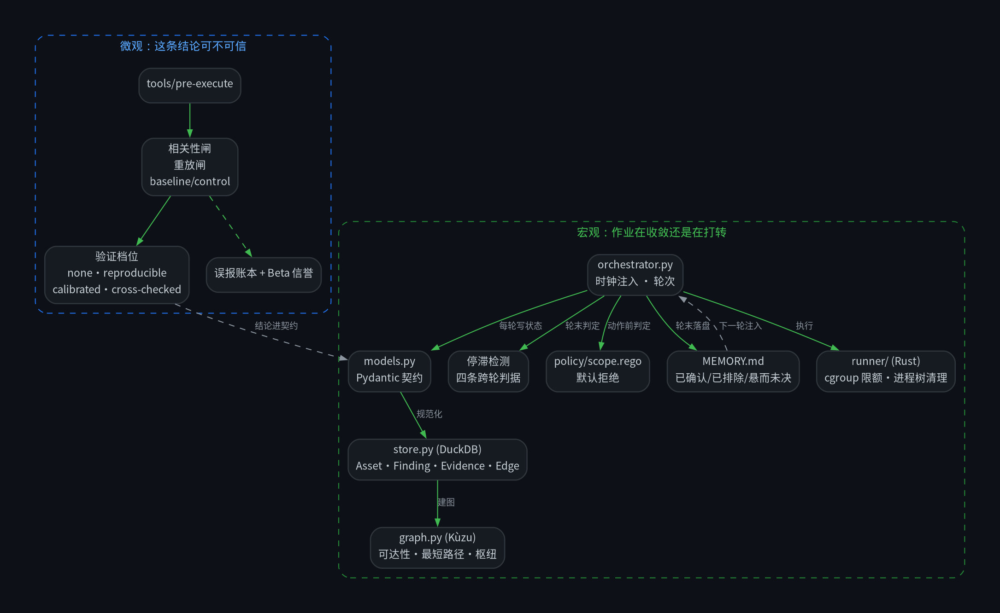
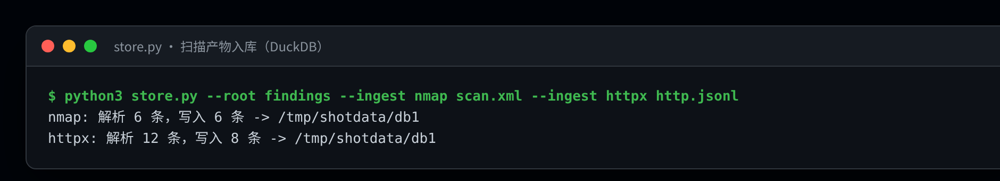
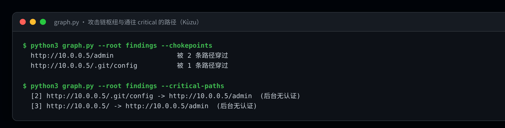
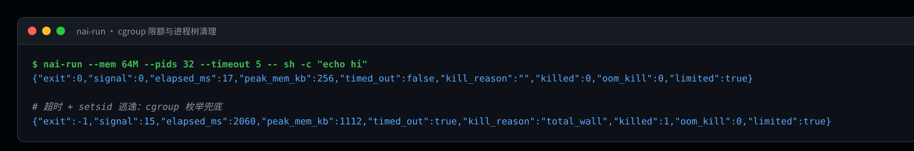

# 渗透测试 Agent 系统的设计哲学

一套安全测试编排层的设计取舍

---

## 起因

先说一个具体的事。

某个下午我让六路 agent 同时跑六个安全测试方向。内存 10G，负载 11，看着还行。

四十分钟后：零分，**六个方向的有效产出加起来 0 字节**。每一路的日志最后一句都是：

```
（第 2 轮，耗时 222s）（本轮没有写 ROUND.md）
```

降到单路重跑，同一道题：**46 秒**收敛，四个文件正常落盘。

我最初以为是资源问题。不是。

**六路之间没有任何共享结构**——没有统一时钟、没有共享记忆、没有谁在轮次之间看趋势。它们不是一支队伍，是六个单体，恰好同时跑在一台机器上。

这件事让我把整套东西重想了一遍。下面是我现在的判断，以及每个判断的代价。

---

## 一、智能体组织：成员是岗位的填充者，不是系统的主体

先说这一条，因为下面所有设计都是从它推出来的。

现在讨论多智能体，默认范式是"协作"：几个 agent 通过消息交流、协商、互相纠正，最后收敛到一个结果。这套范式里，**成员是主体**——系统的能力是这些成员的聚合，你加一个成员就多一份能力，成员之间怎么说话决定整体表现。

我做这套东西时选了另一条路：**结构是主体，成员是岗位的填充者**。

打个比方。一家公司不是"一群人的集合"，而是"有岗位、有流程、有汇报线的结构"。人可以换，结构不变；新人进来读岗位说明书就能上手，不需要跟每个人重新建立关系。反过来，一群自由职业者约着开会，也能完成一个项目，但那不是一个组织——换个成员，整个协作方式就要重新磨合。

这个区别不是命名偏好，它决定了三件具体的事。

### 一、协调靠共享状态，不靠对话

组织里成员之间不说话。它们读写的是同一份状态：

| 共享状态 | 回答什么 | 代码位置 |
|---|---|---|
| 任务契约 | 这条任务干什么、谁批准、花多少、产出归谁 | `council/contract.ts` |
| 覆盖账本 | 哪个资产、哪个方向、用什么手段测过，结果是什么 | `coverage.ts` |
| 证据库 | 每条断言挂着哪些证据、可信度多少 | `provenance.ts` |
| 人才档案 | 谁在什么形态上失手过 | `council/roster.ts` |

任务契约的设计意图写得很直白：

```ts
/**
 * 系统里有三种执行体：确定性代码工具（nuclei/semgrep/rabin2）、专项 agent、
 * 自研 worker。它们形态各异，但对外必须收敛成同一种东西——否则每加一个工具
 * 就要在下游到处加分支，三公的职责也就落不到实处。
 *
 * 契约固定四件事：干什么（direction+target）、谁批准（requestedBy）、
 * 花多少（estimatedCost）、产出归谁（claimId）。其余都是执行细节。
 */
```

"对外必须收敛成同一种东西"——这句话是组织能成立的技术前提。如果三种执行体对外是三种形状，那"加一个成员"就要改下游，组织就退化成五个 if-else。

### 二、覆盖账本：组织存在的实证理由

如果只留一条证据说明"为什么需要组织而不是单体 agent"，我会选这个。

`coverage.ts` 的注释：

```ts
/**
 * 覆盖账本：记住「什么还没测」，和「测出了什么」一样重要。
 *
 *   没有 stamp，但同项目里别的 host 有 stamp  → 这个 host「未扫描」
 *   整个项目一条 stamp 都没有               → 只能说「覆盖未记录」，不能说「未扫描」
 *
 * 这和 claim 系统里 inconclusive ≠ clean 是同一条原则：**没有数据不等于阴性**。
 * 把「没测过」和「测过没发现」混为一谈，是安全评估里最常见也最难发现的一类错误。
 *
 * 为什么这套东西必须有：真实观测里，六轮分析全压在同一条路上，没有任何机制说
 * 「A、B、C 都试过了，还剩 D」。人靠记忆做这件事，模型靠上下文做这件事，
 * 而上下文会被压缩、会被遗忘。账本不会。
 */
```

最后那句是我做组织的直接动因：**六轮分析全压在同一条路上，没有任何机制说"A、B、C 都试过了，还剩 D"**。

这件事单体 agent 做不到。不是因为它不聪明，是因为它需要的信息——"整个项目里哪些测过、哪些没测"——不在它的上下文里，也不可能塞进去。上下文会被压缩、会被遗忘。

组织能记住，因为记忆不放在任何成员的脑子里。

### 三、成员之间不说话，所以能热插拔

这一点在第三节展开，这里只说结论：**加一个成员只是多一种"能接什么活"的选择，不改变别人怎么工作。**

靠对话协调的系统做不到这一点——新成员进去，老成员的行为会因为对话而改变。

### 这个选择的代价

组织是有成本的结构。

**跨领域的问题归属变难。** 一个漏洞同时涉及 Web 和认证逻辑时归哪个方向？现在归给证据最强的一侧，另一侧只作支撑。这经常是错的，而且没有一个"跨领域岗位"能接它。

**结构本身要维护。** 契约、账本、档案都要写，都要保持一致。这些不是免费的——它们是整个系统里代码量仅次于判定逻辑的部分。

**成员不能自由发挥。** 一个 agent 想出了跨方向的好办法，它必须通过修改覆盖账本或提出新假设来表达，不能直接跑去做。这种约束在小任务上是纯损失。

## 二、三公：确定性代码的边界

这套东西的职责分成三块，内部叫三公：

| 角色 | 负责 | 实现 |
|---|---|---|
| 丞相 | 盘点已知、找缺口、提假设 | 确定性代码 |
| 太尉 | 拆任务、选执行体、维护状态 | 确定性代码 |
| 御史大夫 | 授权、限流、超时、熔断 | 确定性代码 |

**三块全是确定性代码，一个模型调用都没有。**

这是设计决定，不是省事。下面逐条说为什么。

### 丞相为什么是代码

```ts
/**
 * 全部是确定性代码，这一点是设计决定而不是省事。丞相要做的事——
 * 盘点已知、找缺口、提假设——依据的是**结构**（哪些 claim 停在 hypothesis、
 * 哪些证据只有一条独立路径、哪些方向从没跑过），不是语义。让模型来读这些
 * 结构，只会把一个能算对的问题变成一个可能算错的问题。
 */
```

具体点：判断"接下来测什么"，输入是可枚举的——哪些断言还在 `hypothesis`、哪些只有一条证据路径、哪些资产从未被任何证据触及。一个 `SELECT` 算得出来。

让模型做，等于把 `O(n)` 的确定计算换成概率推理。三个后果：准确率下降、成本上升、**失败归不了因**——你没法说清是数据不对还是模型今天状态不好。

需要模型的地方只有一处：**这个目标可能有什么问题**。丞相负责把它框进可验证的范围：

```ts
export interface Hypothesis {
  readonly id: string
  readonly statement: string   // 具体到哪个界面/参数/信任边界
  readonly falsifyBy: string   // 什么观测能推翻它，写不出来就不该提
  readonly direction: Direction
  readonly target: string
}
```

`falsifyBy` 必填。这一条拦掉了大量"可能存在风险"式的伪假设——**写不出证伪条件的，不是假设，是猜测**。

### 预算和越界为什么必须分开

这是我在整套系统里最重要的一条判断。

```ts
/**
 * 不管预算。预算是「我打算花多少」的策略问题，属于调度层；御史管的是
 * 「能不能碰这个目标」的授权问题。把两件事塞进一个角色，会让「预算不够」
 * 和「越界」看起来是同一种拒绝，而它们的处置完全不同：前者可以加预算，
 * 后者一步都不能退。
 */
```

**两种拒绝的语义相反。**

预算用完，可以申请额度、换便宜工具、降频率——可协商。越界了，没有任何补救，只能退。

早期版本把它们混成一个 `denied`，上游没法决定该做什么，只能统统停下。翻当时的记录：被拒绝的动作里**超过八成其实是预算或限流**，本该"等一下重试"，却被当成终局。大约每五个任务有一个因此提前收工。

拆开之后御史只管三件事，全是确定性代码：

```ts
export interface CensorPolicy {
  readonly rateWindowMs: number      // 限流窗口
  readonly rateMaxPerWindow: number  // 窗口内最多几次
  readonly breakerThreshold: number  // 连续失败几次开闸
}
```

限流是计数器，熔断是连续失败计数，授权是集合判定。**没有一件需要判断。**
真实的 `authorize()` 是四条独立否决线，任一触发即拒绝：

```ts
authorize(contract: TaskContract): Authorization {
  if (this.policy.allowedHosts.length > 0) {
    const host = hostOf(contract.target)
    if (host === undefined) {
      return deny('scope', `cannot determine host from target "${clip(contract.target)}"`)
    }
    if (!this.policy.allowedHosts.some((h) => h.toLowerCase() === host)) {
      return deny('scope', `host "${host}" is not in the authorized list`)
    }
  }

  const breaker = this.breakers.get(contract.direction)
  if (breaker !== undefined && breaker.openUntil > this.now()) {
    return deny('breaker-open', `${contract.direction} breaker open ...`)
  }

  const window = this.windowOf(contract.direction)
  if (window.length >= this.policy.rateMaxPerWindow) {
    return deny('rate-limit', `${contract.direction} already ran ${window.length} time(s) ...`)
  }

  if ((contract.timeoutMs ?? 0) > this.policy.maxTaskTimeoutMs) {
    return deny('timeout-too-large', `requested timeout ... exceeds the cap ...`)
  }

  return { allowed: true }
}
```

有个细节值得单拎：**`host` 解析不出来时是拒绝，不是放行。** 目标写成 `target.internal:8080` 而 `hostOf` 返回 undefined 时，如果默认放行，整个范围闸就失效了——"解析失败"必须导向更严格的那一侧。这类默认值选边，比规则本身更容易出事。


### 太尉什么都不判断

```ts
/**
 * 它不做判断——判断在丞相（测什么）和御史（能不能测）。太尉只负责
 * 把已批准的假设变成一串可执行的任务，盯着它们跑完，再把结果整理成
 * 一份能直接喂回丞相的东西。
 *
 * 一条任务被御史驳回不该拖垮整个计划：其他方向照跑，被驳回的那条
 * 带着原因进汇总。计划是一次性的，可观测性不是。
 */
```

最后那句是硬约束：**计划可以废，但不能没有记录**。

所以即使任务被拒，它也带着拒绝原因进结果集。下一轮盘点时，"因为越界被否了"和"测了没结果"是两种不同的信息，不能混。

### 一个反例：为什么"判断"不能交给模型

三公这套边界最容易被质疑的地方是：**我怎么知道哪些事不该问模型？**

举个我自己踩过的例子。原本有一步是判断"一条证据够不够支撑断言"，看上去需要理解语义，交给模型似乎合理。

后来发现它的实现是这样的：

```ts
const inExecuted = anchors.filter((a) => executedText.includes(a.value.toLowerCase()))
if (inExecuted.length > 0) return { ok: true, strength: 'strong', ... }
```

而 `executedText` 是模型自己写的字符串。跑了个实验：写两段含正确路径文本的"证据"，换两个标签——

```
两条自述之后的 status = confirmed
```

**没有一个真实请求。** 因为阈值是两条独立路径，而"独立"由模型自己贴的标签决定。
修好之后，同一条断言的四种证据：

| 证据来源 | independentPaths | relevance | status |
|---|---|---|---|
| 模型自述的执行命令 ×2 | 2 | `[weak, weak]` | `hypothesis` |
| 模型传入的产物文本 ×2 | 2 | `[weak, weak]` | `hypothesis` |
| 系统读取的文件 ×2 | 2 | `[strong, strong]` | **`confirmed`** |
| 系统读取，但两条 pathKey 相同 | **1** | `[strong, strong]` | `partial` |

第一行的 `independentPaths=2` 和 `hypothesis` 并排放着，就是这条边界的形状：**路径数照数到 2，强度不够，状态就是不动。**

第四行是反向对照：两份证据都是系统读的、都强，但声明的是同一条路径，独立路径仍只算 1。独立性和强度是两个维度，任何一个不够都上不去。


这件事的教训不是"要加一道检查"，而是：**当输入本身来自被验证对象时，任何判定都会退化成自证。** 这不是靠提示词或更严的规则能解决的，是结构问题——要么输入来自系统（文件、argv），要么这个判定不该存在。

现在证据的来源位（`executedTrusted` / `artifactTrusted`）只有系统能设，模型传什么都不认。这属于"确定性代码管边界"的延伸：**不只判断要确定，判断的输入也要确定。**

---

## 三、副 agent 能热插拔，前提是组织稳定

注册表里三十多个执行体，按方向和形态（CLI / MCP / 子 agent）分。加减不影响主循环。

能插拔，不是因为"插件化"这个词，是因为**协调靠结构不靠对话**。

反过来说：靠对话协调的系统里，每加一个成员，通信成本往上走一截，新成员还会通过对话改变老成员的行为。那种架构里热插拔是幻觉——你能插进去，但它会改变整体行为。

这里成员不说话，读写同一份状态。加成员只是多一种"能接什么活"的选择。

### 一个故意的保守决定

人才档案记每个执行体的履历，但**不自动改选择**：

```ts
/**
 * 刻意只做记录，不自动改选择。样本量小时统计不可信，让一次偶发失败自动降权，
 * 会把「今天网络抖了一下」固化成「这个工具永远排最后」。
 */
```

这条我仍认为是妥协不是最优解。自动降权在长期看是对的，但**一次深度的安全测试任务总共可能只有几十次工具调用，分到每个执行体上只有个位数样本**。在这个量级上做统计推断，得到的不是知识，是噪声的固化。

所以选择是：档案让人和模型看得见"谁在什么形态上失手过"，但不替它们做决定。

同一条注释里还提到另一半：

> 评分函数如果对零样本返回 0，新工具永远排最后、永远拿不到样本。

这两条合起来是同一个判断：**在小样本下，任何自动调整都会自我实现**。要么把新工具钉死，要么把一次偶发失败钉死。

---

## 四、为什么需要一个主控，以及要它提供什么

这套东西不是单体 agent 加一堆工具，它需要一个宿主提供几样能力。我没有做过横向评测，只说清楚我需要什么，以及为什么这些不能在应用层做。

### 一、拒绝必须是不可撤销的

```ts
 *   1. 范围闸：ctx.tools.guard() —— 单调拒绝，与注册顺序无关，不可被其它插件 force-allow
```

**"单调拒绝"**：任何插件都不能把另一个插件已经拒绝的动作放行。

这是整层安全设计的**前提**，不是优化。没有这个性质，你永远不知道后面有没有别的东西开了口子——你的闸变成了"建议"，而不是"闸"。

这也是为什么这些检查不能写成 prompt 里的一句话：**提示会被绕过，拒绝不会。**

### 二、拦截点的语义必须明确

我在这里踩过一个坑，值得完整说一遍。

```ts
 *   - pre-step 的顺序不保证（cordis 的 prepend 是 unshift，后注册者更靠前），
 *     所以安全拦截一律走 guard，不走 pre-step。
```

最早把范围检查放在 `pre-step` 里。测试全绿。

真实运行时发现某些拒绝不生效。查下来：后注册的插件被 `prepend` 插到了前面，它先返回"继续"，我的检查**根本没被调用**。

`pre-step` 是 waterfall——可以被短路。`guard` 不是——它的语义是"全部都要跑，任一拒绝即拒绝"。

从那以后定死一条规矩：**安全拦截一律走 guard，不走 pre-step。**

如果你的宿主只提供一种拦截机制，这个坑根本不会暴露。它会在客户现场暴露。

### 三、我以为不重要、结果很重要的是：插件之间的加载顺序不影响安全

这一条是上一条的推论，但值得单独拎出来。任何"我注册得早所以我在前面"的假设，在支持 `prepend` 的系统里都是错的。

所以现在的做法是：**不依赖顺序，只依赖语义**。安全类逻辑必须挂在"全都要跑"的接缝上，而不是"按顺序跑、可以被短路"的接缝上。

---

## 五、时间驱动，不是目标驱动

这是整套设计里最反直觉的一条。

### 目标驱动在哪里失效

主流 agent 框架假设目标是可定义的：跑到测试通过、跑到问题解决。这个假设在编码任务里成立。

但**渗透的目标一开始就是未知的**——你不知道有什么资产、哪条路通、哪个洞存在。这时候"跑到目标达成为止"会退化成"一直跑"，因为没有达成条件。

### 两次实测

**第一次**：比赛开始五分钟后它还在"等待开始"。翻日志发现它自己 `sleep` 到一个时间点，那时间点是它从上下文**推算**的，比真实时间晚五分钟。

**第二次**：一道题给四十五分钟，它在第 **41 分钟**还在做"再确认一下"的验证工作。那轮结束时什么都没产出。

**模型的时间感完全来自它读到的最后一句话。** 上下文里没时钟，它就没有时钟。

### 现在的做法

每轮 prompt 开头强制注入：

```
**时钟**：现在 14:23（北京时间），本题剩余 12 分钟，截止 14:35。
```

副作用是它开始**主动取舍**。剩十二分钟时会选"做完最小可验证的一步"，而不是"铺开三个方向"。不是提示词教的，是数字摆在那里。

配套两个超时判据，**分开算**：

- **总时长**：跑太久就收，管效率
- **无输出**：连续 N 秒日志没有新字节就判卡死，管无效消耗

这两件事在真实运行里是两种情况。一次扎实的逆向可能十五分钟都在吐中间结果，不该掐；卡住的连接十五分钟一个字不吐，必须掐。


这两个值都不是拍的：

- **单轮总时长**最初定 300 秒，实测连侦察都做不完——基线里四道简单的题分别耗时 **499 / 502 / 512 / 510 秒**。300 秒会在一轮产物写出来之前把进程杀掉，整轮产出全丢。改成 900 秒。
- **无输出容忍**最初定 180 秒，误杀了正常的长工具调用（volatility 扫内存、angr 符号执行都可能静默好几分钟）。改成 420 秒。

两个都往上调，理由相反：一个是"还没干完就被杀"，一个是"正常静默被当成卡死"。超时参数不能凭直觉，得先量清楚正常行为长什么样——我在没有基线时定的这两个值，两个都太紧。

沿用第二节的判断：**这是两个确定性判据，不该合成一个"是否健康"的模型判断。**

### 一个诚实的补充

时间驱动不是放之四海皆准。**在短任务上它是纯负担**——两分钟能做完的事被切成轮次，加注入上下文和写产物的开销，实际变成四分钟。

它适合的是"目标未知、可能无限展开"的任务。这个适用边界我还没摸准。

---

## 六、记忆是结构，不是日志

这条改了三次才定下来，过程本身说明了问题。

**第一版**：把上一轮的原始日志尾部塞进下一轮，理由是"信息不丢"。

结果下一轮表现更差。日志里全是失败尝试、挫败的语气、反复的自我怀疑。模型读到这些，倾向于放弃当前方向去试别的，或者干脆重复已经排除过的路径。

**第二版**：只放一句话摘要。

出现另一个问题：有些轮次这句话是空的（超时被掐停，产物没写出来），下一轮等于失忆。

**第三版**：只放三类——**已确认、已排除、悬而未决**。

其中"已排除"是后来才补进状态的。原来它只活在单轮产物里，解析完就丢，**等于每轮从零开始排除**。补上之后，同一批任务从"跑三轮都在试同一条死路"变成"第二轮直接跳过"。

真实 `MEMORY.md` 的一个片段：

```
## 已排除（不要回头再走）
- 用 GIL 解释该代码在 CPython 下天然安全 —— 依据：GIL 不提供跨多条字节码
  的互斥；race_repro.py 在无锁 transfer 上稳定得到 src=-100、dst=200
- 把无条件 return True 当作本题所指的并发缺陷 —— 依据：该返回值问题在
  单线程、余额不足时也会发生，不产生并发非法终态
```

每条排除都带依据。**没依据的排除，下一轮会重新试。**

### 还有一条违反直觉的纪律

> 一旦把交付物写进指定文件，本轮结束就停，不要继续验证。

写完答案后继续"再验证一遍"、把整个 deadline 耗光的轮次，我见过不止一次。收束条件必须是"产出存在"，不能是"我觉得够了"。

### 停滞检测：跨轮的模式

单轮看不出停滞。四条判据全是累积量：

| 判据 | 对应什么 |
|---|---|
| 连续 N 轮无进展 | 最直接的停滞 |
| 高比例轮次靠日志回捞 | agent 从不写产物，记忆一直断着 |
| 切过阶段却零裁决 | 换方向也没用 |
| 悬空假设 ≥5 条 | 用"提假设"冒充进展 |

命中两条判停滞，自动切探索档，理由注入下一轮。

刻意**用规则不用模型**：为"是不是卡住了"再付一次模型调用不划算，而四条判据都能从状态里算出来。这套东西里凡是能算的都不问模型——和第二节同一条原则。

---

## 七、取舍清单

前面每节都埋了代价，这里汇总。

| 决定 | 换来了什么 | 付出了什么 |
|---|---|---|
| 组织而非协作 | 能收敛、可归因、热插拔 | 跨领域问题难归属；一个漏洞同时涉及 Web 和认证时，只能归给证据最强的一侧 |
| 确定性代码管边界 | 判断可复现、失败可归因 | 处理不了意外。限流按方向和窗口计数，目标返回 429 带 `Retry-After` 时看不见 |
| 时间驱动 | 在未知目标上能收敛 | 短任务是纯负担；两分钟的事变四分钟 |
| 结构性记忆 | 跨轮不丢结论 | 丢细节。有时候细节正是突破口，但放进记忆会污染判断 |
| 依赖 guard 而非 pre-step | 安全拦截不会被短路 | 绑定宿主的拦截语义；换一个只提供 waterfall 的宿主，这套要重写 |
| 小样本不自动降权 | 不把偶发失败固化成结论 | 明显失手的工具还会被反复选中 |

最后一行是我目前最不确定的一条。

---

## 八、没解决的问题

**独立性判断仍靠模型自述。** 第二节那个实验修好了"证据来源"，但"两条证据是否来自不同验证原理"仍由调用方声明一个 `pathKey`。换标签就是新路径。真正解决需要系统按命令指纹自动派生，但那会误伤"用不同角色验证"这类合法场景——同一个命令换一个用户身份跑，确实是一条新的独立路径。

**组织规模的上限不知道。** 现在六个成员还能协调，二十个会怎样我没有数据。

**什么时候该从组织退回单体。** 有些任务简单到不需要结构，硬套组织是浪费。这个判断现在是靠人，没有规则。

**没有在真实客户项目上跑过。** 所有验证都是合成数据和自建任务集。这一点必须说清楚，因为上面所有"实测"都还停留在自建环境里。

---

## 代码在哪儿

- `dsh-secops/src/council/` — 三公（`chancellor` / `marshal` / `censor` / `roster`）
- `dsh-secops/src/guards.ts` — 范围闸、目标提取
- `dsh-secops/src/provenance.ts` — 证据模型与可信度判定
- `dsh-secops/src/index.ts` — 接缝注册（guard / pre-step 的语义差异）
- `engine/orchestrator.py` — 多轮编排：时钟、记忆、停滞检测
- `engine/policy/scope.rego` — 授权范围策略，默认拒绝 + 15 条单测
- `engine/runner/` — Rust 执行层（cgroup 限额 + 进程树清理）

跑起来的样子：









---

## 最后

我在做这套东西的过程中反复在同一个地方犯错：**用不确定的东西去做确定的事**。

预算、限流、超时、权限、状态、盘点——这些看上去是"agent 该思考的事情"，实际上每一条都有确定答案。交给语言模型，得到的不是智能，是**不确定的确定性问题**。

反过来，真正需要模型的地方比我原以为的少：这个目标可能有什么问题、这条线索值不值得跟、这个发现够不够格报出去。

这个切分点在哪，我还在摸索。