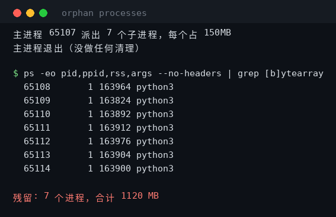
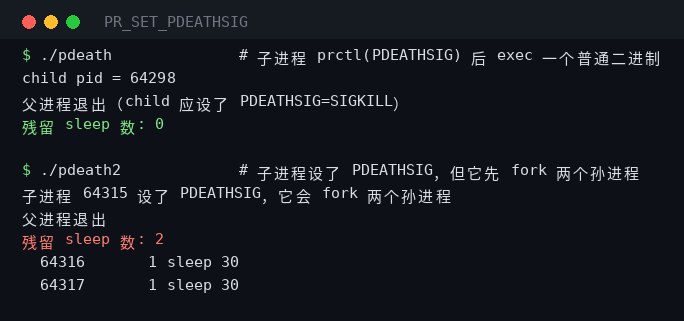
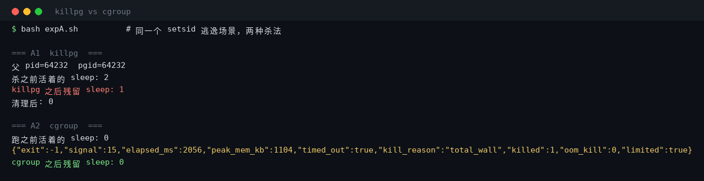
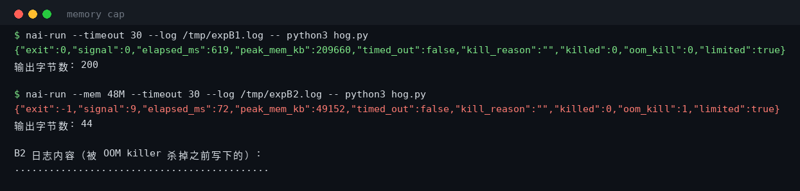
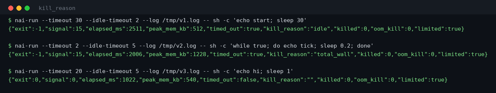

# Linux 进程树为什么杀不干净

killpg、PDEATHSIG、cgroup 三种成员关系的取舍

---

## 七个进程不知道自己该死了

先看一个能复现的现象。一个主进程 fork 出七个子进程，每个吃掉 150MB，然后主进程退出：

```
$ ./orphan
主进程 65107 派出 7 个子进程，每个占 150MB
主进程退出（没做任何清理）

$ ps -eo pid,ppid,rss,args --no-headers | grep [b]ytearray
  65108       1 163964 python3
  65109       1 163824 python3
  65110       1 163892 python3
  65111       1 163912 python3
  65112       1 163976 python3
  65113       1 163904 python3
  65114       1 163900 python3

残留: 7 个进程，合计 1120 MB
```



注意第二列：**七个 `1`**。

PPID 从刚退出的主进程变成了 1，也就是被 init 收养。这一列是"孤儿"的定义，也是整篇文章的起点——**内核没有"父死子必死"这条规则**。父进程退出时，内核的处理是把子进程挂到 init 下面，而不是顺手杀掉它们。

这已经足够解释那 1120MB 是怎么留下的。但真正的问题不是"它们没死"，是**没人知道它们是谁**。

要杀掉它们，得先能列举出来。而这正是难点。

---

## 杀一棵树需要什么

发信号需要一个**地址**。Linux 给你三种：

| 地址 | 由什么定义 | 谁在维护 |
|---|---|---|
| pid | 单个进程 | 内核 |
| pgid（进程组） | 一起放进同一个终端作业 | 内核，可被 `setpgid` 改 |
| sid（会话） | 一次登录/一次作业 | 内核，可被 `setsid` 改 |

三种地址里，只有 pid 是不可逃的——一个进程改不了自己的 pid。后两种**都是可以被进程主动切断的关系**。

### `setsid` 一条命令就把关系断了

```sh
set -m                       # 必须开 job control，否则 $! 不是 pgid
sh -c 'setsid sleep 40 & sleep 40 & wait' &
PG=$!
kill -TERM -$PG
```

一条 `setsid`，那个 `sleep 40` 就新建了自己的会话，脱离了原来的进程组。实测：

```
杀之前活着的 sleep: 2
killpg 之后残留 sleep: 1
```

两个进程，杀掉了一个，跑掉了一个。**跑掉的那个不是因为权限、不是因为信号被忽略，是因为它换了一个地址簿。**

这里有个我自己踩的坑，值得先说：第一版脚本里写的是 `kill -TERM -$!`，结果一个都没杀掉。因为**非交互 bash 没有 job control**，后台任务的 pid 不等于 pgid——我拿着一个进程号去杀一个不存在的进程组。输出只会显示"残留 2"，看起来像 `killpg` 完全无效，实际是我打偏了。加上 `set -m` 才对。

这种细节不看输出根本发现不了，而看输出也会看错——**"没杀掉"和"杀错地方"在结果上长得一模一样。**

---

## 第二个尝试：让父进程死的时候带上子进程

Linux 提供了一个看起来正对症的机制：

```c
prctl(PR_SET_PDEATHSIG, SIGKILL);
```

子进程在父进程死亡时收到信号。它不需要枚举——内核记着父子关系，父进程一死，内核代劳。

### 先纠正一个常见的错误认知

我原本以为它有致命缺陷：`exec` 之后这个设置会被清空，所以对长命令没用。

**错了。实测：**

```c
pid_t pid = fork();
if (pid == 0) {
    prctl(PR_SET_PDEATHSIG, SIGKILL);
    execlp("sleep", "sleep", "30", (char *)NULL);   // exec 一个普通二进制
    _exit(127);
}
usleep(300000);
_exit(0);        // 父进程直接退出
```

```
child pid = 64298
父进程退出（child 应设了 PDEATHSIG=SIGKILL）
残留 sleep 数: 0
```

`sleep` 是普通二进制，`PDEATHSIG` **保留下来了**，父进程一死它就被杀。



man page 的原文是：这个设置在 `fork` 后清空、在执行 **set-user-ID / set-group-ID / 带 capabilities 的二进制**时清空。普通 `exec` 不影响。我记错的是这个细节。

### 但它仍然不够，原因在另一个地方

再做一个实验。子进程设了 `PDEATHSIG`，不过在死之前它自己 fork 了两个孙进程：

```c
prctl(PR_SET_PDEATHSIG, SIGKILL);        // 只有这一层设了
execlp("sh", "sh", "-c", "sleep 30 & sleep 30 & wait", (char *)NULL);
```

```
子进程 64315 设了 PDEATHSIG，它会 fork 两个孙进程
父进程退出
残留 sleep 数: 2
  64316       1 sleep 30
  64317       1 sleep 30
```

**两个孙进程都活着，PPID 又变成了 1。**

`PDEATHSIG` 是**一次性的、只作用于直接子进程**的设置。它不继承。孙进程不知道自己的祖辈死没死，内核也不会替它推断——因为"祖辈"这个概念在内核里就不存在，只有"父"。

而真实系统恰恰是多层的：主进程 fork 中间层，中间层 dispatch 真正干活的 worker。`PDEATHSIG` 只能保证第一层跟着死。

---

## 换思路：不通知，记账

两次失败有一个共同点：**都在试图"通知"某些进程去死。**

通知需要知道发给谁，而"知道发给谁"要求能枚举成员。可用的枚举依据只有 pid、pgid、sid、父子关系——全是可切断的关系。

所以换一个问法：**不问"谁该死了"，问"谁属于这里"。**

Linux 的 cgroup v2 就是这个。挂一个 cgroup，把子进程放进去，之后：

```sh
$ cat /sys/fs/cgroup/<name>/cgroup.procs
```

列出来的是**当前真实的所有成员**，不管它们换过几次会话、`exec` 过几次、fork 了多少层。

关键差别在**继承性**：cgroup membership 自动继承，子进程出生时就在父进程的 cgroup 里，它没有任何系统调用可以退出。`setsid` 能逃出进程组，但逃不出 cgroup。

### 同一个场景，两种结果

```
=== killpg ===
杀之前活着的 sleep: 2
killpg 之后残留 sleep: 1

=== cgroup ===
{"exit":-1,"signal":15,"elapsed_ms":2056,"peak_mem_kb":1104,
 "timed_out":true,"kill_reason":"total_wall","killed":1,"oom_kill":0,"limited":true}
cgroup 之后残留 sleep: 0
```

| 方式 | 杀之前 | 残留 |
|---|---|---|
| `killpg` | 2 | **1** |
| cgroup 枚举 | 2 | **0** |



JSON 里那个 `"killed": 1` 就是 `killpg` 杀不到、最后靠 cgroup 枚举补掉的那一个。

### 为什么要扫三轮

```rust
for _ in 0..3 {
    let pids = cgroup_pids(dir);
    if pids.is_empty() { break; }
    for p in &pids {
        unsafe { libc::kill(*p, libc::SIGKILL) };
        killed += 1;
    }
    std::thread::sleep(Duration::from_millis(50));
}
```

`SIGKILL` 发出到进程真正消失之间有窗口期，这期间还可能发生 fork。三轮足够收敛，又不会无限等。

**这不是"多扫几次保险一点"，是因为 `cgroup.procs` 是快照而不是队列。** 你读它的那一刻看到的成员，和 50 毫秒后的成员可能不同。任何"读一次然后逐个杀"的实现都会有残留，只是残留概率不同。

---

## 一般化：关系和归属

把两次失败的教训抽出来，是一条可以搬走的判断：

**当你需要"处理一组东西"时，先分清你要的是关系还是归属。**

- **关系**由双方共同维持，任何一方都能单方面切断。进程组、父子、会话都是关系。
- **归属**由容器单方面记账，成员无法自行退出。cgroup membership 是归属。

杀进程树这个问题之所以难，不是因为信号不好用，是因为**几乎所有可枚举的关系都是可切断的**。一旦你把依据从"关系"换成"归属"，问题就消失了——不是解决了，是不存在了。

这条判断不止用于进程。任何"我持有子对象列表"的设计都在依赖关系，而子对象一旦能自己 deregister，你的列表就会漏。区别只在于它是否有动机去 dereg。

---

## 顺手解决的：内存到底是谁吃的

同一个 cgroup 还能写内存上限。这是附带收益，但它解决的是另一个长期困扰我的问题：**事后说不清内存是谁吃的。**

### 同一段吃内存的脚本，两种待遇



| | 不给上限 | 限 48M |
|---|---|---|
| 峰值 | 209660 KB | **49152 KB** |
| 耗时 | 619 ms | 72 ms |
| 退出 | 0（正常） | signal 9（被 OOM killer 杀） |
| `oom_kill` 计数 | 0 | **1** |
| 输出留存 | 200 字节 | **44 字节** |

三个数值得单独说。

**`peak_mem_kb` 正好等于 49152 = 48 × 1024。** 不是"接近"，是精确顶在上限上。这说明限额是硬的，不是软约束——软限额在真出事的时候等于没有。

**`oom_kill: 1` 是内核记的**，读自 `memory.events`：

```
low 0
high 0
max 0
oom 0
oom_kill 1
```

不是我自己采样猜的。所以事后能直接回答"是哪一次运行触发了 OOM"。

这里踩过一个静默失败的坑：第一版用 `read_u64()` 去解析 `memory.events`——那个函数期望整个文件是一个数字，对这个多行 `key value` 格式必然失败，**返回 0 而不报错**。表现是 OOM 明明发生了，报告里永远是 `oom_kill: 0`。它不会崩，只会一直告诉你"没事"。

**输出留了 44 字节，不是 0。** 进程被 OOM killer 干掉之前写的 stdout 没丢，日志里留着 44 个点（脚本每分配 1MB 打一个点）。如果输出全丢，"它被杀之前跑到哪一步"就无从判断了。

---

## 两个超时判据不能合成一个

原本只有一个判据：总时长。问题是它把两种完全不同的情况混在一起。

- 一次扎实的逆向，十五分钟都在吐中间结果——**正常工作**，不该掐
- 一个卡住的连接，十五分钟一个字都不吐——**死锁**，必须掐

只用总时长，第一种会被误杀；只用无输出，第二种会永远挂着。

```rust
// （省略 poll 循环的前半段）
if now >= hard_deadline {
    kill_reason = "total_wall";
    timed_out = true;
    break;
}
if !opts.idle.is_zero() {
    let sz = log_size(&opts.log);
    if sz != last_size {
        last_size = sz;
        last_change = now;
    } else if now.duration_since(last_change) >= opts.idle {
        kill_reason = "idle";
        timed_out = true;
        break;
    }
}
```

实测三种情况分得很清楚：

```
卡住：  {"timed_out":true,"kill_reason":"idle","elapsed_ms":2511}
太慢：  {"timed_out":true,"kill_reason":"total_wall","elapsed_ms":2006}
正常：  {"timed_out":false,"kill_reason":"","elapsed_ms":1022}
```

第一行是 2 秒没输出就判卡死，根本没等到 30 秒的总时长上限。



`kill_reason` 这个字段是刻意加的。只有一个"超时了"的布尔，事后没法区分"它卡住了"和"它太慢"——前者要修实现，后者要调预算，完全是两件事。

**`idle` 默认是关的**（`Duration::from_secs(0)`）。没配过的系统按总时长杀，行为可预期；默认就带 idle 的话，那些启动慢、前几分钟不产出日志的工具会被无辜掐死。

---

## 代价

**容器里通常没有可写的 cgroup v2。** Docker 里 `--cgroupns=private` 且没给特权时，`/sys/fs/cgroup` 是只读的，整套机制用不了。处理方式是降级回裸 `subprocess`，并在结果里标一个字段：

```python
# 是否真的走了 supervisor。False 表示降级到裸 subprocess，
# 此时 peak_mem_kb / oom_kill / killed 都不可信。
supervised: bool = True
```

**不假装降级之后还是一样的。** 调用方看到 `supervised=False`，就知道自己失去了进程树清理和内存归因。

**`cgroup.kill` 不是每个内核都有。** 它从 5.14 引入，但发行版编译时可以不开。我这台 6.19 就没有。所以实现是遍历 `cgroup.procs` 逐个 `SIGKILL`——效果等价，代价是多几次系统调用。

**上限设太小会连正常启动都过不去。** 48M 那次 72 毫秒就死了，连 200 个点都打不完。上限必须先在不设限的情况下量一次峰值再定。

---

## 一句话收束

**不要用信号去杀一棵树，因为"树"这个关系在内核里不存在。**

内核里只有父、只有进程组、只有会话——每一样都可以被对方单方面切断。cgroup 记的不是"谁是谁的儿子"，是"谁属于这里"，而归属是记账，不是关系。

能算准的事交给内核，别用信号去通知。
